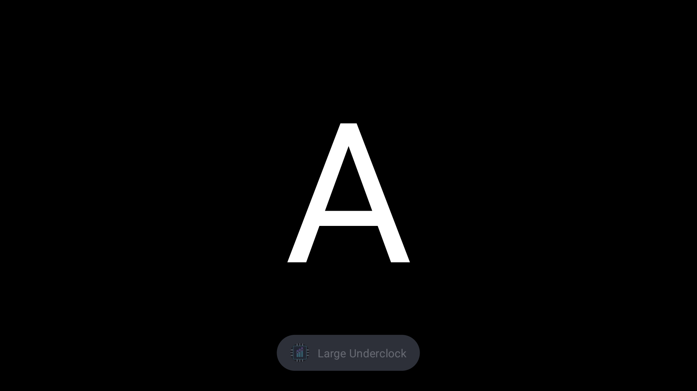

# ClusterTune function tests with four letter apps

Physical device: AYN Thor, Android 13. The first device tests in this conversation covered
profile resets. This follow-up expands that work to the app's functions and their interactions.

## Four independent test apps

The `test-apps` module builds four separate APKs: `com.aure.clustertune.fixture.a`, `.b`, `.c`,
and `.d`. Each displays its white letter on a black background. They request no permissions,
have no network access, and save no state. They are not included in the ClusterTune APK.

D is useful on this device. With A and B assigned different profiles and C and D unassigned,
we can replace either screen independently: A+B, A+D, C+B, and C+D. We also swap their screen
positions and use custom CPU/GPU assignments whose higher limits come from different apps.
That checks the merge rule rather than only choosing one complete profile.

Normal is Medium Underclock, A is Large Underclock, and B is Small Underclock. Each step
checks the actual CPU/GPU limits, detected packages and display IDs, and effective profile
ownership. The report retains switching times, History, errors, and restoration evidence.

The apps are static by default. A test intent can redraw the same letter every frame to
exercise real SurfaceFlinger statistics and Auto Tune. This tests frame reporting and session
control; it is not a game-performance benchmark.

## Problems found while running the matrix

The first launcher used an unsupported Android command option. A later launcher also passed
shell redirection as a literal argument through UiAutomation. Both fixture mistakes were
corrected before the final runs. Their reports remain available as historical evidence.

The corrected tests exposed failed profile applies through both PServer and real root. App
detection identified the new letter correctly, but a clock-verification failure could leave
the previous profile active. Logs recorded effective CPU limits above the requested limits,
including recognized Stock values. A short readback-only delay did not solve this.

Fixed underclocks now complete their write batch and restore write protection before checking
the result. Exact verification can wait briefly while an independent minimum-frequency boost
is higher than the requested ceiling. It still requires the requested maximum and permissions
to match. It does not rewrite the value during the wait, accept a higher cap, or change the
system's boost vote. The wait is bounded to two seconds for a boost and 40 milliseconds for an
ordinary mismatch. Auto Tune's actuator keeps its existing immediate/session verification.
There is no idle timer or fixed-profile recovery loop.

The controls run also caught an Android foreground-service start deadline during rapid overlay
stop/start commands. The overlay now acknowledges each foreground start in `onStartCommand`,
including a dismiss that immediately stops again. A rapid restart scenario exercises this path.

## Toasts and overlay Back behavior

Most switching scenarios temporarily disable profile-switch toasts. The dedicated toast case
enables them, allows Android's background-message quota to settle, checks the announcement,
and captures the actual screen. It then verifies that disabling the setting suppresses the
next message. The original setting is restored afterward.

The overlays deliberately keep keyboard/controller focus with the underlying app. Back is
therefore delivered to that app; it does not dismiss the overlay. The controls test checks this
behavior and tests the overlay's own Close button. The earlier test incorrectly expected Back
to close it.

## Evidence

- [PServer function matrix](research/letter-apps/pserver-final.json)
- [Root switching matrix](research/letter-apps/root-final.json)
- [Additional controls](research/letter-apps/controls.json)
- [Full Android regression runner](research/letter-apps/regression-runner.log)
- [Initial corrected-launcher failures](research/letter-apps/pserver-corrected-launcher.json)
- [Root failures before the verification change](research/letter-apps/root-before-readback-fix.json)
- [Why a short readback delay was insufficient](research/letter-apps/root-readback-attempt.json)
- [First 80-switch check with boost-aware verification](research/letter-apps/boost-verification-stress.json)

## Final results

| Run | Result |
| --- | --- |
| PServer function matrix | 42 passed; original 120 Hz limitation resolved by the retry below |
| Root switching matrix | 23 passed |
| Final controls, including the external notification-permission check | 13 passed, including the subsequent Overview retry |
| Actual recent-app card retry | 4 scenarios passed through PServer and 4 through Root |
| Physical 120 Hz Auto Tune checks | 6 target/display combinations passed through each method |
| Live 120 → 60 → 120 through the game panel | Passed through PServer and Root |
| Actual reboots with restoration enabled and disabled | 2 passed |
| Full Android regression run | 99 passed; 1 manual client-death fixture skipped |
| Relevant Android regression after the final overlay fix | 7 passed |
| Letter-app overlays, HUD and reconnect checks after that fix | 5 passed |
| JVM tests | 564 passed |
| Lint | No errors; 56 app warnings and 4 warnings per letter-app variant |

Three separate 80-switch stress runs passed with the final clock-verification change:
the isolated stress check, the complete PServer matrix, and the Root matrix. Each switch
checks the actual limits rather than treating correct app detection as proof of application.

The matrix covers forward/reverse switching, assigned and unassigned apps, Home and Back,
closing an assigned app, background detection, shared and custom assignments, live assignment
edits/removal, both displays, independently replaced screens, swapped screens, and crossed
CPU/GPU requests. It also covers sleep/wake, manual Stock and underclocks, profile CRUD/order,
export/import/invalid data/defaults, Auto Tune start/stop/ownership/manual override/disable,
static and rendering surfaces, all five tile actions, both pickers, invisible edge swipes,
HUD, History, toast settings, appearance, missing permissions, reconnects and update handoff.

The updater downloaded and Android parsed the real release APK. Its handoff opened Android's
install-permission screen; the test did not install a replacement over the tested build.
Support-screen navigation and browser link resolution also passed.

Notification denial is tested from outside the app because revoking that runtime permission
ends the instrumented app process. The actual missing-permission dialog appeared, and the
original grant and permission flags were restored exactly. Suppressing delivery with an app
operation was an invalid substitute: Android still reported notifications as enabled.

### Original test limitations and completed retries

The original 60 Hz Auto Tune check passed: a saved 120 FPS target was limited to the display's
actual 60 Hz. Android accepted a preferred 120 Hz mode, but both physical screens continued
reporting 60 Hz. That original assertion failure remains in the raw report. The user later
selected actual 120 Hz through the device's game control panel, allowing the completed retry
below. Ordinary profile switching does not require 120 Hz.

The original Overview check did not open cards with a Recents key event. That result was
initially recorded as unavailable. The user's requested retry established that real cards can
be opened with a short swipe to reveal the hidden navigation bar, followed by a continuous
swipe up and stationary hold. This supersedes the earlier claim that the launcher's cards
could not be tested. The retry checks actual card touches and resulting clock limits; the
earlier Home/Back/reopen scenario only reopened an existing task through a launch command.
The user's default launcher and navigation settings were not changed.

The letter apps exercise real frame reporting and Auto Tune session control. They do not
measure demanding games, thermal behavior over hours, or every possible vendor intervention.
The observed clock-apply failures and overlay crash were fixed; this does not establish the
cause of every original report of a random Stock profile.

### Actual recent-app cards: completed retry

The corrected driver opens Overview with a real swipe-and-hold gesture and touches the card's
visible screen bounds. It seeds A/B/C before each scenario, then performs all tested switches
through the cards. It does not start the selected package with a launch command. The driver
uses one continuous touch with a stationary pause, and first performs a short reveal swipe
when an immersive app has hidden the navigation bar. Both a Recents key event and Android's
direct Recents action failed to open the cards in the earlier attempts. A preliminary version
of the repeat driver also failed because its long first gesture did not reliably reveal the
bar; that test-input failure was corrected before the final runs.

All four scenarios passed on both PServer and Root:

1. Open A, go Home, open Overview, and touch A's actual card. Large Underclock returns.
2. Touch B, C, A cards in that order, three times. B receives Small Underclock, unassigned C
   receives the normal Medium Underclock, and A receives Large Underclock.
3. Open Overview over A and cancel with Back. A and its profile return correctly.
4. Leave assigned B on the second display while touching C/A/C/A cards on the primary display.
   B remains on display 4, the selected app remains on display 0, and effective ownership and
   actual combined CPU/GPU limits match the visible assigned apps.

That is 14 actual card selections per method, 28 across both methods, with no failed final
scenario. The standalone card-control test also passed with the corrected driver. The checks
verify real clock limits, detected packages/displays, and contributing profile assignments.
The existing CPU/GPU write protection and production app detection code required no changes
for this retry.

As part of the investigation, only the stock Android Overview process was restarted once.
That alone did not make the direct Recents action work. No default launcher, navigation mode,
saved launcher data, app permissions, or display refresh settings were changed.

- [PServer card-selection results](research/letter-apps/recents-retry/pserver.json)
- [Root card-selection results](research/letter-apps/recents-retry/root.json)
- [Standalone card-control result](research/letter-apps/recents-retry/controls.json)
- [Actual Overview screen from the first working gesture](research/letter-apps/recents-retry/initial-working-gesture-overview.png)
- [Earlier unsuccessful repeat-driver experiment](research/letter-apps/recents-retry/pserver-gesture-driver-first.json)

To repeat only these scenarios, use `-e letterApps 1 -e letterCaseFilter 04b,04c,04d,04e`
with `LetterAppsDeviceTest#pserverFunctions` or `#rootAppSwitching`. The standalone controls
method accepts `-e letterControls 1 -e letterControlFilter 04`. Failure to expose a real card
now fails these checks instead of marking the case unavailable.

### Physical 120 Hz and live refresh changes: completed retry

With both physical screens at 120 Hz, PServer and Root each passed six combinations: saved
Auto Tune targets of 120, 60 and 240 FPS on each display. The running target was respectively
120, 60 and 120 FPS, while every saved target remained unchanged. Each combination collected
three fresh frame samples, around 120 FPS. A lower Auto Tune target does not cap the app's
rendering rate. Disabling Auto Tune restored the normal profile.

The final live tests used the `60 FPS MODE` / `120 FPS MODE` button in the OEM game control
panel (`com.odin.dualscreen.assistant`), on the lower screen. The driver opens that panel by
reproducing the protected hardware-menu button event, then clicks the actual refresh UI
control. Other accessibility services remain enabled during this optional system-UI test;
ClusterTune itself does not request accessibility access.

Both PServer and Root passed 120 → 60 → 120 with rendering A continuously open on the primary
screen. Auto Tune followed each display event without relaunching A or editing its assignment.
Three fresh samples at each step measured about 60 and 120 FPS respectively, and A's saved
120 FPS target stayed unchanged. These results resolve the earlier unverified 120 Hz check.

There was also a separate OEM system failure during an earlier attempt using Android's
Smooth Display tile. One PServer cycle through that tile passed; a subsequent attempt froze
Android. Its system trace records a lock cycle entirely inside the OEM display service:
`setAppRequest` holds the display-service lock while waiting for DisplayModeDirector's lock;
`updateRefreshRateSettingLockedForX6` holds the latter while waiting for the former. Input and
display queries then stopped responding. This evidence identifies the immediate system
freeze, but does not prove which concurrent event triggered it. Stopping the test did not
release the locks, so the saved app data was restored and the device was restarted. The final
game-panel cycles passed afterward. No production change was made for this OEM issue.

Earlier failed attempts to expose/click the Smooth Display tile are retained as test-driver
history. The current optional driver uses the user's OEM panel, makes bounded physical-mode
reads, and reports invalid/busy dump output clearly instead of treating it as display data.
It no longer reorders Quick Settings tiles or uses Smooth Display.

- [PServer: both displays and saved targets](research/letter-apps/120hz-retry/pserver-current.json)
- [Root: both displays and saved targets](research/letter-apps/120hz-retry/root-current.json)
- [PServer: live game-panel switches](research/letter-apps/120hz-retry/pserver-live.json)
- [Root: live game-panel switches](research/letter-apps/120hz-retry/root-live.json)
- [Interrupted earlier Smooth Display attempt](research/letter-apps/120hz-retry/root-live-interrupted.json)
- [OEM display deadlock evidence](research/letter-apps/120hz-retry/oem-display-deadlock.txt)

Repeat the current-mode checks with `-e letterApps 1 -e letterCaseFilter 29b
-e letterExpectedHz 120`. Add `-e letterLiveRefresh 1` and select `29c` for the optional Thor
panel cycle. Run either method separately and avoid concurrent device UI/display diagnostics.
The game-panel driver also requires the already-authorized root access to open its protected
menu; this is only a test fixture requirement. The app's tuning path still uses the selected
PServer or Root method.

### Reboot evidence

With no assignments, sleep profile or Auto Tune active, a real reboot with restoration enabled
restored Large Underclock: CPU maxima 1,459,200 / 1,785,600 / 1,843,200 kHz. A second reboot with
restoration disabled left Stock maxima: 2,016,000 / 2,803,200 / 3,187,200 kHz. Distinct kernel boot
IDs and three matching samples per reboot are retained in [the reboot report](research/letter-apps/reboots.json).
No launch of ClusterTune was needed to obtain the post-boot limits.

An initial connection attempt timed out while the first reboot was still starting. The driver
was corrected to tolerate reconnect timeouts, then observed the same reboot; no extra enabled
reboot was substituted. The existing wireless debugging port was temporarily persisted for
these reboots and its original empty persistent setting was restored afterward.

Additional evidence:

- [Actual denied-notification permission and restoration](research/letter-apps/notifications-denied.json)
- [Physical refresh-mode diagnostic](research/letter-apps/refresh-diagnostic.json)
- [Final controls runner](research/letter-apps/controls-final-runner.log)
- [Post-fix Android regression runner](research/letter-apps/post-overlay-regression-runner.log)
- [Post-fix letter scenarios](research/letter-apps/post-overlay-letter-checks.json)
- [Original verification errors](research/letter-apps/verification-failures-before-fix.log)

## Reproducing the letter tests

Build and install the four variants described in [test-apps/README.md](../test-apps/README.md),
along with the debug app and instrumentation APK. These tests are opt-in and temporarily
replace assignments/settings, then restore them. Use an otherwise idle test device.

`LetterAppsDeviceTest#pserverFunctions` accepts `-e letterApps 1`; its Root counterpart is
`#rootAppSwitching`. `-e letterCaseFilter 01,02,13` selects scenario prefixes. The controls method
is `LetterControlsDeviceTest#actualTileOverlayAndUpdateControls` with `-e letterControls 1`;
`-e letterControlFilter 31,32` narrows it. The raw full PServer result above includes the
unavailable physical refresh-mode assertion. Reboot preparation is a separate opt-in method,
`LetterControlsDeviceTest#prepareReboot`, with `-e letterBoot enabled` or `disabled`; a device
driver must perform the real reboot, observe the limits, and restore the user's setup.

## Final restoration

The app was fully stopped before restoring its original saved data. All settings match the
pre-test backup exactly, including PServer selection, enabled profile toasts and edge handle,
disabled Auto Tune/sleep/boot restoration, and appearance. All three original assignments,
saved profiles, normal CPU/GPU values and selected Large Underclock profile were preserved.
Only the current effective-profile record and History changed when Large Underclock was
deliberately reapplied for cleanup.

The device was left with Large Underclock selected and verified CPU maxima
1,459,200 / 1,785,600 / 1,843,200 kHz and GPU 680,000,000 Hz. The final quiet read also confirmed
CPU minimums 307,200 / 499,200 / 595,200 kHz and protected minimum permissions `0440`.
At the end of the original matrix, both display preferences were cleared and refresh settings
were back at their original 60 Hz; the later 120 Hz retry supersedes this display state. The
screen timeout is still 600,000 ms, and the OEM mode remains unchanged at `0`. Temporary
notification/overlay access changes and the persistent wireless debugging property were
restored. The four letter apps remain installed and are stopped.

See [saved-data and device restoration checks](research/letter-apps/restoration.json),
[actual hardware values](research/letter-apps/restored-hardware.txt), and
[the final screen](research/letter-apps/restored-device.png).

The recent-app retry also ended with a fresh comparison against its own pre-retry backup.
All settings matched exactly, and profiles, three assignments, and normal/selected Large
Underclock values matched. Only the effective-profile record and deliberate cleanup History
entries differed. Actual final CPU maxima were 1,459,200 / 1,785,600 / 1,843,200 kHz, GPU was
680,000,000 Hz, and minimum permissions were `0440` on all three policies. See the
[retry restoration check](research/letter-apps/recents-retry/restoration.json) and
[restored screen](research/letter-apps/recents-retry/restored-device.png).

The subsequent 120 Hz retry restored its own fresh pre-retry backup, preserving the user's
new 120 Hz choice. All app settings, saved profiles, three assignments and normal/selected
Large Underclock values matched. Final CPU maxima were 1,459,200 / 1,785,600 / 1,843,200 kHz,
GPU was 680,000,000 Hz, and CPU minimum permissions were `0440`. Both physical displays were
independently verified at 120 Hz. Quick Settings order, empty display preferences, screen
timeout, OEM performance mode and debugging settings matched their originals. Auto Tune and
sleep mode are off; the four letter apps are stopped. See the
[120 Hz restoration check](research/letter-apps/120hz-retry/restoration.json) and
[restored app screen](research/letter-apps/120hz-retry/restored-device.png).
